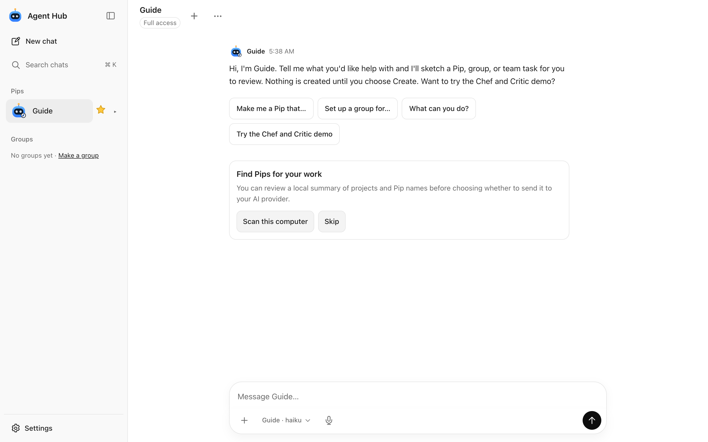
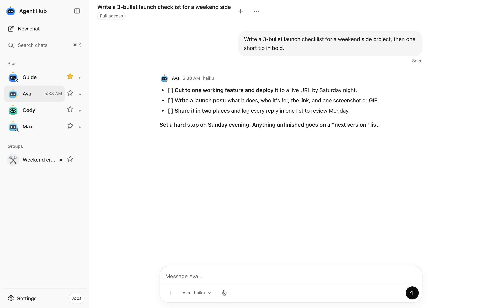
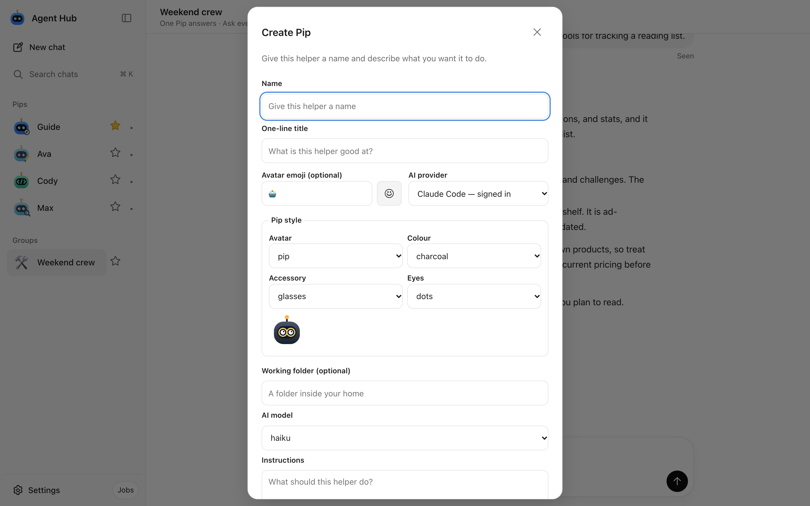
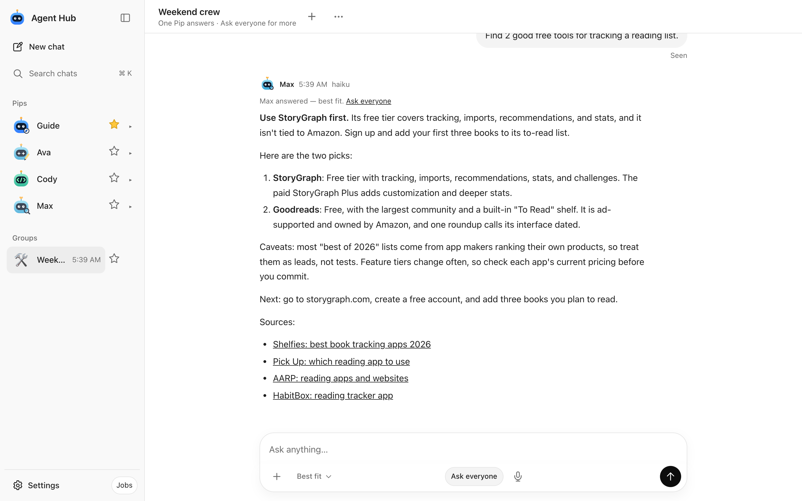
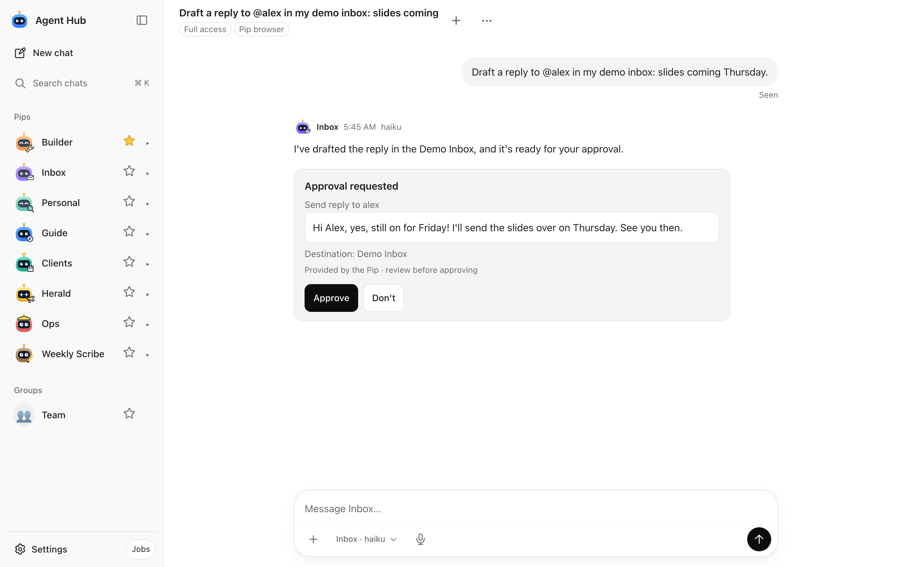
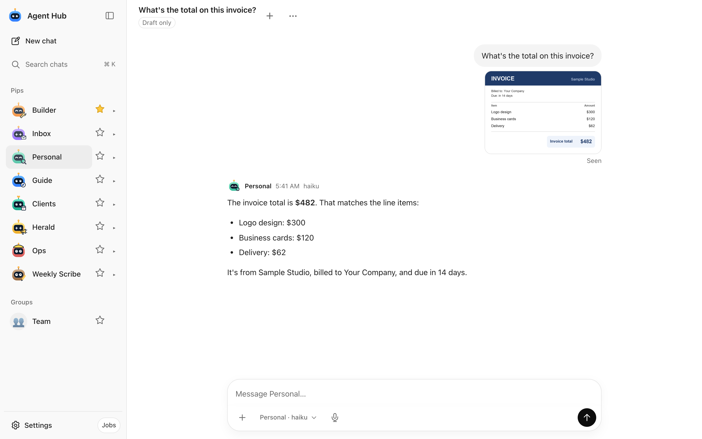
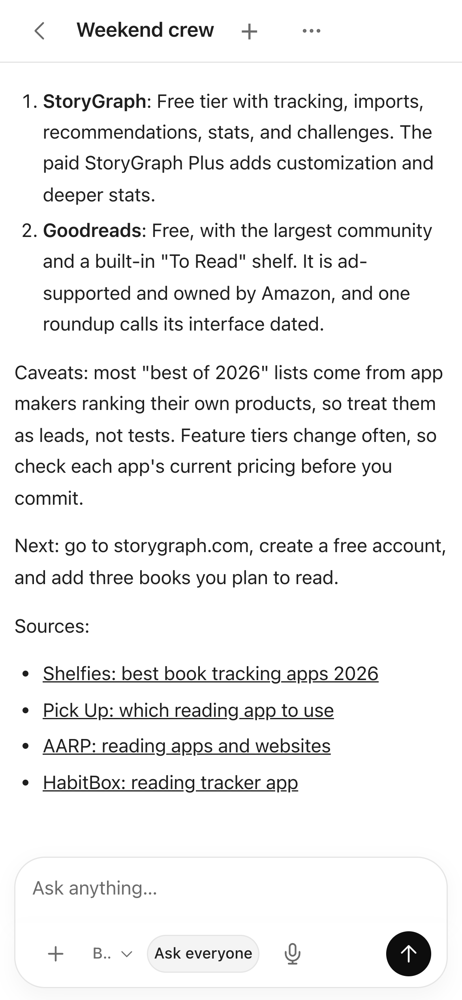
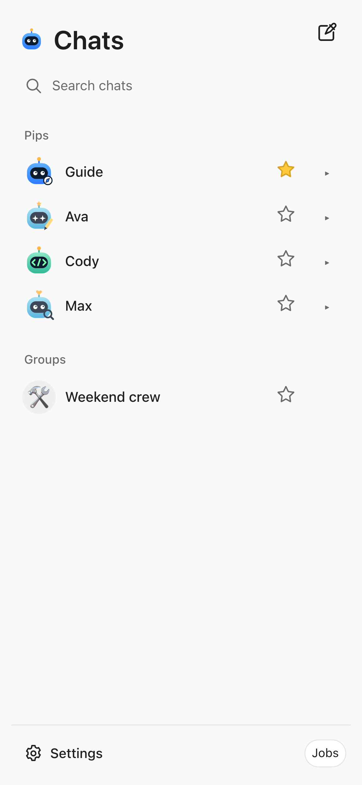

# Agent Hub

Agent Hub is a private, local chat workspace for running AI helpers called **Pips** with your signed-in Claude Code or Codex CLI.

## Screenshots

These screenshots show the included demo workspace and sample Pips.

| Guide first run | Chat |
| --- | --- |
|  |  |

| Create a Pip | Team task |
| --- | --- |
|  |  |

| Approve before anything is sent | Paste or drop a screenshot |
| --- | --- |
|  |  |

| Phone chat | Phone Pip list |
| --- | --- |
|  |  |

It is for people who want a simple place to ask coding and research helpers for work, coordinate a small team of agents, and review results from a computer or phone.

## Requirements

- macOS or Linux
- Python 3.9 or newer
- [Claude Code](https://docs.claude.com/en/docs/claude-code/setup) (run `claude` once to sign in) and/or [Codex CLI](https://github.com/openai/codex) (run `codex login`), on a plan that includes CLI use

Hub itself has no package install, build step, or separate model API key. The CLI needs its usual provider connection.

## Quick start

```sh
git clone https://github.com/brettr7388/agent-hub.git && cd agent-hub && python3 hub.py
```

Open <http://127.0.0.1:4700>, then enter the login token shown once in the terminal. Save it for later logins. If you lose it, stop Hub and run [`python3 hub.py --reset-token`](SETUP.md#first-run). Keep the terminal open while Hub is running. Hub creates `config.json` on first start.

To use a different port, stop Hub, edit the `port` value in `config.json`, and start Hub again. For example, set `"port": 4800` and open <http://127.0.0.1:4800>. If Hub has not created the file yet, copy `config.example.json` to `config.json` first.

## Your first five minutes

Start with **Guide**, the built-in Pip. Its greeting and starter prompts work without a model call. Ask Guide to suggest a helper for a concrete job, read the proposed instructions, then choose whether to create it. You can also try the Chef and Critic demo.

Open a Pip and give it a small task. Pin useful chats, or create a group to ask a few Pips related questions. For work that can be split into steps, choose **Run as a team task**. Review its results and any proposed changes before merging them.

Pips are regular Claude Code or Codex CLI sessions with your normal setup. Full-access Claude Pips run in Claude's auto permission mode, so they can search the web, run commands and edit files like a normal session, and anything that sends, posts, buys or deletes asks you first with an **Approve / Don't** card. Switch a Pip to **Private Pip** or **Draft only** for tighter limits. Never paste passwords into chat; use the Pip browser and Saved logins instead. A full-access Pip runs as you, so it can also reach your browser sessions and your OS credential store; use a Private Pip when that matters. Full details and limits: [SECURITY.md](SECURITY.md#pip-access-in-detail).

## Pips and team tasks

A Pip has a name, instructions, a model, and a working folder. Working folders must be inside your home folder; for example, `~/Projects/my-app` on macOS or Linux. Groups route a question to the best fit; mention a Pip by name to choose it, or use **Ask everyone** for independent replies. Team tasks split work, compare alternative answers, or run research, building, and review in order. File merges remain an explicit owner action.

To use existing instruction folders, set `external_agent_dirs` in `config.json` to a list of parent directories. Each subfolder containing `CLAUDE.md` or `AGENTS.md` appears as a **Linked** Pip. Hub reads its instructions without editing or moving that folder. Archive hides a Pip; **All Pips → Show hidden → Unarchive** restores linked and Hub-created Pips. Linked Pips use the same access defaults and mode choices as other Pips. Mode switches live in Hub's SQLite overlay; the CLI runs in the selected working folder normally, where it may create runtime files.

After Guide's first greeting, an optional scan card can suggest Pips from local project metadata. You can also scan later from Settings → General → Scan this computer. Nothing scans until you choose Scan, and you can inspect the preview before sending it to a model.

In a group you create, Pips can hand work to one another automatically using a final standalone `@@handoff target-name: task` line outside quotes and code. Ordinary `@name` text does not delegate work. Hub removes the marker from chat text and passes the recipient the full original request and sender message. A chain allows at most three handoffs. The handoff routes context; it does not itself write files or send anything outside Hub. The recipient keeps its own engine and permission settings, and a handoff does not bypass any separate approval those settings require. Draft-only Pips can receive handoffs under their restricted tool profile. If group routing is ambiguous, Claude may use an isolated classifier with tools disabled. Codex uses a deterministic fallback: the last responder if still in the group, otherwise the first Pip in the group.

## Attach screenshots and files

**Paste a screenshot with Cmd+V** (Ctrl+V on Windows/Linux) in the message box. Plain-text paste still works. Drag images or multiple files anywhere onto the conversation and release over **Drop to attach**, or use **+ → Attach files**. On a phone, **+** opens the system picker with photos/camera and common file types; camera options depend on the browser and device. Attach up to ten files per message within the configured upload size/quota limits. Chips show a 56 px image preview, filename, size, progress, and a remove button. Send after uploads finish.

Sent images appear in a rounded grid; tap one for the full-size in-app viewer, then close it or press Escape. Other attachments appear as download cards. PNG, JPEG, GIF, and WebP render inline; other image formats remain file downloads. Files are served through the authenticated `/api/file` route with `no-store`; SVG/HTML remain non-executing downloads. Temporary thumbnail URLs stay in your browser and are released when removed, sent, or signed out. Original image bytes and metadata stay in private local storage and are not publicly served or added to service-worker caches. The CLI may send attached content and metadata to its model provider as part of your request.

For an attached-file Claude turn, Hub adds its uploads folder with `--add-dir`, including resumed turns; this does not limit the CLI's other normal access. Codex receives each validated uploaded image with `--image` on both new and resumed turns; all files also keep their local paths in the prompt. Hub rechecks saved upload paths before launching or retrying jobs and applies the selected Pip mode. Offline fake-CLI tests verify the flags and that uploaded bytes can be read; real provider vision and device picker behavior require a live check.

### Chat controls

Each Pip keeps its ongoing chat. Expand its sidebar row to see recent conversations or choose **New chat with …** for a separate session. New conversations take their title from the first message; their ⋯ menu renames or deletes them. Search includes their titles and messages. Deleting the ongoing chat clears its history while keeping the Pip.

Right-click or long-press your message for **Edit and resend**, or press ↑ in an empty composer to edit your last message. The revised conversation starts at that turn. Later messages stay in the collapsed **Earlier versions** switcher; each version can continue separately. Edits and version switches start fresh CLI sessions with a bounded transcript of earlier active turns, because the installed CLIs cannot rewind to an arbitrary message.

The composer mic appears when browser speech recognition is available. Interim words appear live; click again to stop. ⌘⇧O (Ctrl⇧O) starts a new chat with the current Pip, Esc stops the reply, and ⌘/ (Ctrl/) opens the shortcut sheet. Code fences have local syntax highlighting; basic math uses built-in MathML, with unsupported expressions shown as source. PDFs and text uploads show file cards and reach the agent as local paths. Scroll up to read without being pulled down; **Jump to latest** resumes following the reply.

## Exports

Use **Export chat** or **Export everything** from the workspace to download your saved data. Exports include your chat text. Review before sharing — we redact obvious secrets but can't catch everything. Authentication and provider token files are excluded, but chat text, instructions, and other included data can still contain sensitive information.

## Advanced approvals connector

Settings → Connections includes an **Advanced** disclosure. Connect an external approvals queue that speaks the Agent Hub approvals API — most people don't need this. Use the loopback address for the service, such as `http://127.0.0.1:PORT`.

## Use Hub on your phone

For private phone access, install Tailscale on the supported Hub host (macOS or Linux) and your phone, then join both to your tailnet. In the Hub folder, run `python3 hub.py --tailscale` in Terminal, run the exact `tailscale serve` command it prints, then restart Hub. The HTTPS link appears in the terminal and in Settings → General → Phone setup after restart. Open it on your phone with Tailscale connected. Hub does not support Funnel or public port forwarding. See [SETUP.md](SETUP.md) for details.

Search chats filters the sidebar as you type; press Enter or ⌘K for full search. Pips and Groups each show one list, with pinned chats first, followed by activity and then unused chats alphabetically. Lists over twelve offer **Show all N**; the directory keeps large lists in pages of sixty.

## Safety and privacy

Hub stores chats and settings locally. When a Pip uses a model, its prompt and any files it reads may be sent to the provider through the CLI. Hub is designed for one trusted owner, not as a sandbox for untrusted users. Team worktrees separate project changes, but do not isolate the computer. Approval requests rely on Pip instructions and do not intercept actions transactionally. The server requires a login token; protect it like a password.

Hover a message for React and Reply. Right-click a bubble, or long-press it on a phone, for Copy and Retry. Swipe right on a phone to reply.

Reactions have clear meanings: 👍 approves only the proposal in that message, 👎 declines it, ❤️ shows appreciation, and ❓ asks for an explanation. For approval requests, buttons and 👍 send the exact approval or decline to the same Pip; they do not execute the action. Malformed approval blocks are shown as plain text. See [SECURITY.md](SECURITY.md) for the threat model and network behavior.

## Known limitations

- Hub does not send push notifications while the app is closed. Keep the browser open for live updates; reopening refreshes state.
- Phone access requires Tailscale Serve and a running Hub on an awake computer.
- Windows is not supported yet; use WSL only if you are comfortable managing the Linux environment yourself.
- The first visible response can take a while because the CLI must start and the provider may have a queue.
- Model availability, response speed, and usage limits come from your Claude or Codex plan.

## FAQ

**Does Hub charge separately for model use?** No. It invokes your signed-in CLI. Your plan's access and usage limits still apply.

**Can I use it without internet?** Hub's interface and saved history are local, but model replies need the CLI's provider connection.

**Can Pips change files?** Depending on engine and settings, yes. Review instructions and work before approving actions. Draft-only mode is available for more restricted sessions.

**Where are my chats stored?** In the local `data/` directory in the checkout. Back it up with Hub stopped.

**How do I report a security issue?** Follow the private reporting guidance in [SECURITY.md](SECURITY.md).

## License

Agent Hub is available under the [MIT License](LICENSE).

The bundled Mozilla Public Suffix List (`docs/public-suffix-list.dat`) is licensed separately under MPL-2.0; see its [attribution and license note](docs/licenses/Public-Suffix-List.md).
